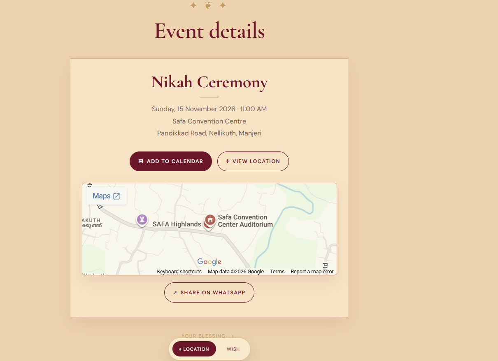
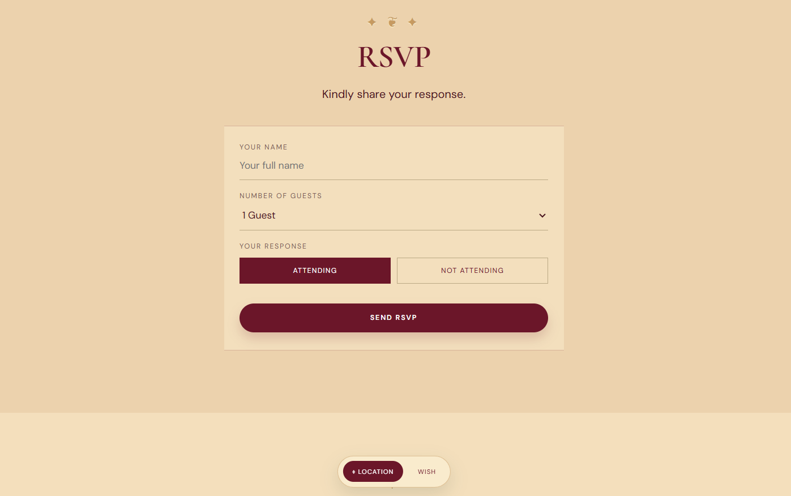
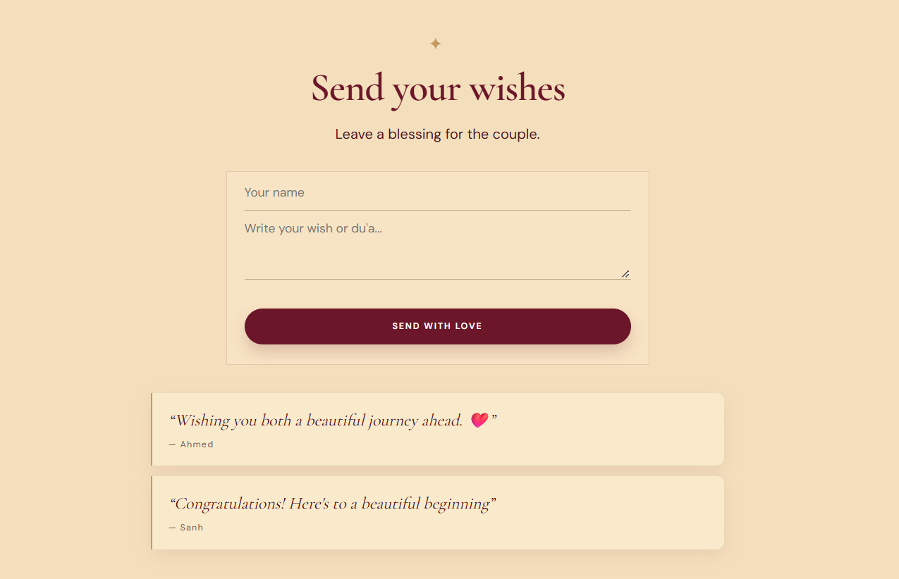

# Nikah Invitation Website

A responsive, interactive digital Nikah invitation built to deliver a memorable wedding invitation experience through elegant visuals, animations, and guest interaction.

🔗 **Live Website:** https://sibili-jashida-nikah.web.app

## ✨ Features

* **Animated Introduction:** An elegant opening animation that introduces the invitation.
* **Interactive Design:** Smooth transitions and scroll-based animations.
* **Wedding Countdown:** A live countdown to the Nikah ceremony.
* **Event Details:** Displays the ceremony date, time, venue, and location.
* **Google Maps Integration:** Allows guests to find the venue easily.
* **RSVP System:** Enables guests to submit their attendance responses.
* **Guest Wishes:** Allows visitors to submit wishes and view recent messages.
* **WhatsApp Sharing:** Makes it easy to share the invitation with others.
* **Responsive Layout:** Designed to work across desktop and mobile screens.

## 🛠️ Technologies Used

* HTML5
* CSS3
* JavaScript
* Google Apps Script
* Google Sheets
* Firebase Hosting

## 📁 Project Structure

```text
wedding-invitation/
├── assets/
│   ├── couple-illustration.jpg
│   ├── gold-ornament.png
│   └── invitation-couple.png
├── 404.html
├── firebase.json
├── .firebaserc
├── .gitignore
├── google-apps-script.gs
└── index.html
```

## ⚙️ How It Works

The frontend is built with HTML, CSS, and JavaScript. Firebase Hosting serves the website, while Google Apps Script processes RSVP submissions and guest wishes using Google Sheets.

## 🚀 Setup

1. Clone or download this repository.
2. Open `index.html` in a browser or serve the project using a local development server.
3. To enable RSVP and guest wishes, configure a Google Sheet with `RSVP` and `Wishes` sheets.
4. Deploy the Google Apps Script backend as a web app.
5. Configure the deployed web app URL in `index.html`.
6. Configure Firebase Hosting if you want to deploy your own version.

## 🔒 Security Notes

* Keep the Google Sheet's sharing permissions restricted.
* Never commit passwords, access tokens, or private credentials.
* Validate public form submissions on the server.
* The public Apps Script endpoint should be protected against unwanted submissions.

## 👨‍💻 Project Purpose

This project explores interactive frontend development, responsive web design, animation, third-party service integration, and serverless form handling.

---

**Built with HTML, CSS, JavaScript, Google Apps Script, Google Sheets, and Firebase Hosting.**
## 📸 Screenshots

### Homepage


### Event Details



### RSVP



### Guest Wishes



